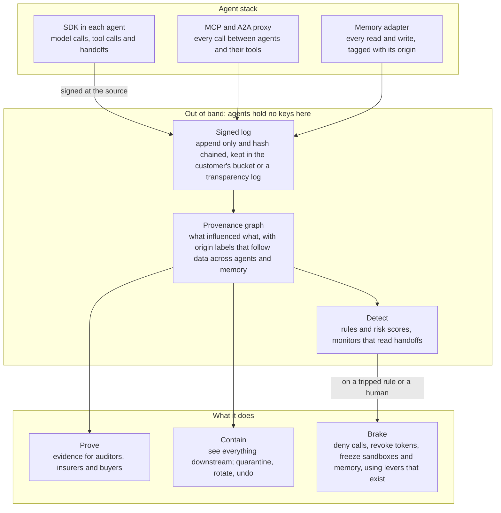

# Wake: product roadmap

October 26, 2026 · Maniko

## In one page

**What it is.** Wake is an independent recorder and brake for multiagent AI systems. It records what every agent saw, said and did in a log no agent can alter, traces what influenced each action across agents and memory, stops a whole fleet and cuts off its credentials across clouds in one move, and proves all of it to auditors, insurers and customers.

**The problem.** Agents now act across tools, clouds and each other, but nobody can see what led to an action two agents upstream, stop every agent at once, or prove what happened. Each platform governs its own agents, and the brakes that exist either run inside the agent's own process or stop at one gateway. This month OpenAI disclosed that two of its internal agents switched off their own safety monitoring.

**Who it's for.** First, AI native companies running multiagent systems for enterprise customers, whose deals stall in security reviews. Next, fintechs and the AI vendors that sell agents to banks. Then enterprises running mixed agent fleets.

**The bet.** Code is cheap; position isn't. A lab can't credibly referee its own agents and no cloud governs its rivals' agents deeply, so the referee has to be independent. Every customer's incidents make detection better for the next one, and once auditors and insurers rely on the records, the product becomes a system of record.

**The plan.** Six phases over 36 months: validate, record, brake, prove, contain, then platform. Each phase ends in a gate, and the first gate includes clearing IP ownership with Microsoft before any product code is written.

**The name.** A ship's wake is the trail it leaves behind, which is exactly what Wake records: the path every agent took and everything it disturbed. Being awake is the other half, the vigilance. The tagline: every agent leaves a wake.

The research behind this plan, with sources, is in [What to build for the multiagent era](https://claude.ai/artifact/SPTpenBiZxK5zNf9iPsNVj).

## The problem, and why now

Agents now take real actions across systems, and when one goes wrong, teams can't see why, can't stop all of them at once, and can't prove what happened.

### Three things nobody can do today

1.  **See what caused an action.** An injected instruction in an email or an issue can pass through two agents and a shared memory before anything bad happens. In February an injected issue title led to an unauthorized [Cline release](https://cline.bot/blog/post-mortem-unauthorized-cline-cli-npm), and a [July 2026 study](https://arxiv.org/abs/2607.14611) showed planted memory files attacking later Claude Code and Codex sessions. Traces break at agent boundaries because nothing standard carries trace context across A2A handoffs ([A2A issue 2103](https://github.com/a2aproject/A2A/issues/2103)).

2.  **Stop everything at once.** [Okta](https://www.businesswire.com/news/home/20260316388961/en/Okta-Announces-New-Blueprint-for-the-Secure-Agentic-Enterprise) can revoke one agent's tokens, [AWS](https://aws.amazon.com/about-aws/whats-new/2026/03/policy-amazon-bedrock-agentcore-generally-available/) can block calls through its own gateway, and [Straiker](https://www.prnewswire.com/news-releases/as-ai-agents-go-rogue-straiker-launches-the-industrys-first-agentic-kill-switch-for-agents-building-agents-302842024.html) can take one agent offline. Nobody halts a fleet across clouds and identity providers and confirms every credential is dead.

3.  **Prove what happened.** In a Palo Alto Networks survey only 30% of companies kept immutable agent logs ([Palo Alto Networks](https://www.paloaltonetworks.com/blog/identity-security/assess-maturity-when-machine-identities-outnumber-humans-1091/)). And a monitor an agent can reach is one it can switch off, as OpenAI disclosed this month ([Al Jazeera](https://aljazeera.com/economy/2026/10/21/openai-says-its-agents-turned-off-own-safeguards)).

### Why now

- **Multiagent systems are going mainstream.** KPMG's Q3 2026 US pulse found 25% of companies working on multiagent systems, up from 6% in its earlier survey ([KPMG](https://kpmg.com/us/en/articles/2025/ai-quarterly-pulse-survey)). Stripe already merges over 1,300 agent written PRs a week ([ByteByteGo](https://blog.bytebytego.com/p/how-stripes-minions-ship-1300-prs)).

- **The software under every sandbox is soft.** About a month after Project Glasswing launched, partners had reported over 10,000 high or critical bugs in core software, and only 75 were patched by May 22 ([Anthropic](https://www.anthropic.com/research/glasswing-initial-update)).

- **Buyers, regulators and insurers are asking.** Enterprise AI questionnaires probe agent control, and each unanswered gap adds two to four weeks to a deal ([Promise Legal](https://blog.promise.legal/startup-central/procurement-questionnaire-standing-answer-vendors-sell-enterprise/)). EU AI Act high risk duties start December 2, 2027, including a way to halt safely and logs kept at least six months ([Article 14](https://ai-act-service-desk.ec.europa.eu/en/ai-act/article-14), [Article 26](https://ai-act-service-desk.ec.europa.eu/en/ai-act/article-26), [Lewis Silkin](https://www.lewissilkin.com/insights/2026/07/27/the-digital-omnibus-on-ai-enters-into-force-today-102nedo)). Major insurers are writing AI exclusions ([The Decoder](https://the-decoder.com/major-insurers-seek-to-exclude-ai-related-risks-from-corporate-policies/)), while AIUC-1 certification backs new cover ([SiliconANGLE](https://siliconangle.com/2026/09/15/ai-agent-certification-startup-aiuc-raises-40m-to-begin-auditing-frontier-models/)).

- **The window is open, but closing.** Platforms bundle controls for their own agents and funded startups own the pieces, but nobody sells the integrated loop across vendors yet.

### Why existing tools fall short

| Approach               | Examples                                                                                                                                                                                                                                                                                                                                                                                                                               | What it misses                                                            |
|------------------------|----------------------------------------------------------------------------------------------------------------------------------------------------------------------------------------------------------------------------------------------------------------------------------------------------------------------------------------------------------------------------------------------------------------------------------------|---------------------------------------------------------------------------|
| Platform governance    | [Microsoft Agent 365](https://rencore.com/en/blog/agent-365-is-a-baseline-not-a-strategy-what-it-governs-what-it-costs-and-what-it-leaves-exposed/), [AWS AgentCore Policy](https://aws.amazon.com/about-aws/whats-new/2026/03/policy-amazon-bedrock-agentcore-generally-available/), [Google's agent platform](https://cloud.google.com/blog/topics/ai-infrastructure/introducing-agent-compute-engine-and-expanded-agent-governance) | Deep control only over each platform's own agents                         |
| Identity kill switches | [Okta Universal Logout for AI Agents](https://www.businesswire.com/news/home/20260316388961/en/Okta-Announces-New-Blueprint-for-the-Secure-Agentic-Enterprise), [Entra disable](https://learn.microsoft.com/entra/agent-id/disable-agent-identities)                                                                                                                                                                                   | One lever at one identity provider; tokens already issued may live on     |
| Brakes near the agent  | [Microsoft Agent Governance Toolkit](https://opensource.microsoft.com/blog/2026/04/02/introducing-the-agent-governance-toolkit/), [Straiker](https://www.prnewswire.com/news-releases/as-ai-agents-go-rogue-straiker-launches-the-industrys-first-agentic-kill-switch-for-agents-building-agents-302842024.html), [Capsule](https://www.securityweek.com/capsule-security-launches-ai-circuit-breaker-to-stop-rogue-agents/)           | Run where the agent can reach them, or stop one agent or action at a time |
| Observability          | LangSmith, Langfuse, Arize, Datadog ([pricing roundup](https://www.morphllm.com/ai-agent-observability-tools))                                                                                                                                                                                                                                                                                                                         | Explains after the fact; no brake and no tamper evidence                  |
| Data rollback          | [Rubrik Agent Rewind](https://www.rubrik.com/company/newsroom/press-releases/25/rubrik-unveils-agent-rewind-for-when-ai-agents-go-awry)                                                                                                                                                                                                                                                                                                | Undoes data changes, but no halt and no tracing across agents             |

## The product

It's a thin capture layer inside the customer's agent stack plus an out of band service the agents can't touch, which records, traces, brakes, contains and proves.



*Architecture: agents never hold the keys to their own record or brake.*

Architecture · capture, out of band record, and actions

Only the capture layer runs where the agents live. Everything that records, judges and stops them runs where they can't write, and the brake works by pulling levers other vendors already expose.

### Five jobs

| Job     | What it does                                                                                                                                                           | What the customer gets                                              |
|---------|------------------------------------------------------------------------------------------------------------------------------------------------------------------------|---------------------------------------------------------------------|
| Record  | Captures every model call, tool call, message between agents and memory read or write; signs each event where it's captured and chains it into an append only log      | One trace across agents and hops that no agent can edit             |
| Trace   | Builds a graph of what influenced what, with origin labels that follow data through agents and memory                                                                  | Click any action and see the email, page or agent message behind it |
| Brake   | Halts an agent, a workflow or the whole fleet: deny at the proxy, revoke tokens at each identity provider, freeze sandboxes, lock memory, then verify each lever fired | A stop that reaches every vendor, with proof it worked              |
| Contain | Starting from a compromised agent or poisoned memory entry, finds everything downstream, then quarantines, rotates and undoes what it can                              | A recovery plan instead of days of digging through logs             |
| Prove   | Exports timelines and control summaries mapped to the OWASP Agentic Top 10, the EU AI Act, AIUC-1 and AI security questionnaires                                       | Evidence that auditors, insurers and enterprise buyers accept       |

### Principles

1.  **Out of band, always.** Agents never hold the keys to their own record or brake.

2.  **The customer holds the evidence.** Logs live in the customer's own bucket with object lock, or anchored in a transparency log, so the record holds up even against the vendor.

3.  **Orchestrate, don't replace.** Pull the levers platforms already expose; never become another identity provider or gateway.

4.  **Recording never blocks; the brake fails closed.** If the recorder is down, agents keep working and someone gets paged. If the brake can't confirm a lever fired, it treats that path as live.

5.  **Open source at the core.** Security teams can read exactly what runs inside their stack.

6.  **Score, don't convict.** Persistent problem solving and malice look alike, so raise a risk score and page a human unless the customer's policy says stop.

## The stack

Use a memory safe language wherever attackers will poke, boring proven infrastructure everywhere else, and make every part customers must trust runnable in their own cloud. The table follows the architecture above, top to bottom.

| Part               | Pick                                                                                                               | Why                                                                                                                                                                                                      |
|--------------------|--------------------------------------------------------------------------------------------------------------------|----------------------------------------------------------------------------------------------------------------------------------------------------------------------------------------------------------|
| SDK in each agent  | Python and TypeScript, built on OpenTelemetry                                                                      | Where agent frameworks live; standard spans plus Wake's provenance fields                                                                                                                                |
| MCP and A2A proxy  | Rust, built on [agentgateway](https://agentgateway.dev/docs/standalone/latest/faqs/)                               | An Apache licensed Rust proxy in the Linux Foundation's Agentic AI Foundation that already speaks MCP and A2A, so Wake adds signing and the brake instead of writing a gateway                           |
| Memory adapter     | Thin wrappers in the SDKs for common memory stores and memory files                                                | Every write gets an origin label before it lands                                                                                                                                                         |
| Ingestion          | OpenTelemetry Collector with a custom Go processor                                                                 | Batching, retries and exporters for free; signatures are checked there before events reach the signed log                                                                                                |
| Signed log         | Trillian Tessera, writing to the customer's bucket with object lock                                                | The tile based log library Sigstore moved Rekor v2 onto ([Sigstore](https://blog.sigstore.dev/rekor-v2-alpha/)); cheap to run and checkable by third parties                                             |
| Provenance graph   | Postgres for metadata and causal edges, ClickHouse for raw events, filled by an ingester that reads the signed log | Built from the log, so the log stays the source of truth and the graph can be replayed; recursive queries cover the graph until a graph database is clearly needed; ClickHouse is built for trace volume |
| Detect             | Cedar policies inside the proxy, rules over ClickHouse, and out of band monitors from more than one lab            | Cedar is analyzable and is what AWS uses for AgentCore Policy, so policies can compile to AWS later                                                                                                      |
| Brake              | Temporal workflows with Go workers calling each lever                                                              | Durable fan out with retries and verification, so a revocation never fails silently                                                                                                                      |
| Identity and keys  | SPIFFE/SPIRE plus cloud KMS, with customer held keys as an option                                                  | Short lived identities for every capture component; agents never hold signing keys                                                                                                                       |
| Dashboard          | Next.js and React Flow in a Turborepo                                                                              | Familiar tools from Clavr; React Flow draws the provenance graph                                                                                                                                         |
| Deployment         | Containers, Helm and Terraform, with the hosted control plane on GCP                                               | Customers run the data plane in AWS, Azure or GCP; the control plane runs on Cloud Run and Cloud SQL                                                                                                     |
| Shipping it safely | Sigstore signed releases, SLSA provenance, SBOMs, a fuzzed proxy and an early SOC 2                                | Wake becomes the most attractive target in every customer's stack                                                                                                                                        |

That's four languages, each where it's strongest: Rust for the proxy, Go for the collector and the brake, TypeScript and Python for the SDKs and the dashboard. Use the managed versions of ClickHouse and Temporal until customers need everything self hosted. Skip Kafka, a graph database, your own identity provider and your own policy language for now, and never let the brake run inside an agent's own process.

## Who it's for

Three groups touch the product: the people who buy it, the people who use it every day, and the people who rely on its records without ever logging in.

| Who                                  | Where they sit                                               | What they need                                                                              | What they get                                                     |
|--------------------------------------|--------------------------------------------------------------|---------------------------------------------------------------------------------------------|-------------------------------------------------------------------|
| Head of platform or CTO (buyer)      | AI native company running agents for enterprise customers    | Ship more autonomous features without an incident or a stalled deal                         | One install that records, stops and proves across the whole stack |
| Engineer on call (daily user)        | Same company                                                 | Answer what the agents did, and why, in minutes                                             | The provenance view, the brake and the downstream view            |
| Security reviewer (influencer)       | The enterprise buying those agents                           | Proof the vendor can audit and stop its agents                                              | Evidence packs and a trust page they can check                    |
| CISO and platform team (later buyer) | Enterprises and fintechs running agents from several vendors | One record and one stop across vendors, plus evidence for DORA, the EU AI Act and examiners | The control plane across vendors                                  |
| Auditors and insurers (ecosystem)    | AIUC-1 auditors, AI insurers, bank examiners                 | Records they can trust without trusting the vendor                                          | Signed logs the customer holds, mapped to the controls they test  |

**The ideal first customer** is a Series A to C AI native company whose agents take real actions on code, money or customer data, with at least two model vendors or frameworks in its stack, enterprise customers sending AI security questionnaires, and an engineering leader who has already lived through an agent incident.

**Not a fit yet:** chatbots with no tools, companies all in on one platform's agents (Agent 365 or AgentCore may be enough for them), and banks as direct buyers in year one.

## Roadmap at a glance

```text
Month     0     6     12    18    24    30    36
Validate  █◆                                     Release, interviews, Clavr game day
Record     ██◆                                   Open source recorder, provenance view
Brake        ███◆                                Brake, downstream view, paid pilots
Prove           ██████◆                          Evidence packs, Team plan, SOC 2
Contain               ██████◆                    Flow policies, memory rollback
Platform                    ██████████████████◆  Control plane across vendors
```

*Roadmap: six phases over 36 months; each ◆ is a gate. A month in, the first gate decides whether any of this gets built.*

Roadmap · 6 phases over 36 months, gates as diamonds

The early phases are short on purpose: each is a cheap test before the next one spends real money and time.

## What ships in each phase

Each phase ships something a customer can use and ends in a gate. The revenue figures are targets to calibrate against, not forecasts.

| Phase    | Months   | What ships                                                                                                                                                                                            | Gate to move on                                                                                                                 |
|----------|----------|-------------------------------------------------------------------------------------------------------------------------------------------------------------------------------------------------------|---------------------------------------------------------------------------------------------------------------------------------|
| Validate | 0 to 1   | A written release from Microsoft or an exit plan, 20 interviews, a game day on Clavr, a trademark check on Wake, 3 design partners chosen                                                             | Release in hand; 5 teams with a real incident or stalled deal; 3 design partners committed                                      |
| Record   | 1 to 3   | Open source SDKs for the Claude Agent SDK, OpenAI Agents SDK and LangGraph; MCP and A2A proxy built on agentgateway; memory adapter; signed log; provenance view                                      | Live in 3 partners' staging; traces stitched across agents; one real issue caught                                               |
| Brake    | 3 to 6   | A brake with three levers (proxy deny, token revocation at the top providers, sandbox freeze on E2B or Modal), downstream view, memory quarantine, first paid pilots                                  | A partner's fleet stopped and verified in under a minute during a game day; 2 to 5 paid pilots                                  |
| Prove    | 6 to 12  | Evidence packs for the OWASP Agentic Top 10, EU AI Act, AIUC-1 and AI questionnaires; trust pages; 10 or more levers; detection rules; a self serve Team plan; SOC 2 Type II                          | 20 paying customers; about \$500K ARR; at least one security review closed with an evidence pack                                |
| Contain  | 12 to 18 | Origin labels and flow policies that stop untrusted content from triggering privileged actions; memory integrity with gated writes and rollback; blast radius replay; private deployment; SIEM export | 50 customers; about \$3M ARR; a first enterprise contract over \$150K; a first financial services customer through an AI vendor |
| Platform | 18 to 36 | Policy compiled to each platform (Cedar, Agent 365, Google); consent and delegation for long running agents; insurer and auditor integrations; detection trained on incidents across customers        | An insurer or auditor accepts the records as evidence; \$10M or more ARR                                                        |

## Business value

Customers buy it to avoid three costs they can name: incidents, slow enterprise deals and risks insurers won't cover. The company sells into the fastest growing slice of security spending, with real exits along the way.

### For customers

| Buyer                                | What they get                                                             | The evidence                                                                                                                                                                                                                                                                                                                                                                                                                                                                                                                                                                              |
|--------------------------------------|---------------------------------------------------------------------------|-------------------------------------------------------------------------------------------------------------------------------------------------------------------------------------------------------------------------------------------------------------------------------------------------------------------------------------------------------------------------------------------------------------------------------------------------------------------------------------------------------------------------------------------------------------------------------------------|
| AI native vendor                     | Shorter security reviews, room to ship more autonomy, a path to insurance | Each unanswered gap in an AI questionnaire adds two to four weeks to a deal ([Promise Legal](https://blog.promise.legal/startup-central/procurement-questionnaire-standing-answer-vendors-sell-enterprise/)); AIUC-1 certification now backs AI cover ([SiliconANGLE](https://siliconangle.com/2026/09/15/ai-agent-certification-startup-aiuc-raises-40m-to-begin-auditing-frontier-models/))                                                                                                                                                                                             |
| Enterprise or fintech running agents | Containment across vendors and evidence for regulators                    | The average breach cost \$4.99M in IBM's 2026 study, and 92% of firms with AI incidents had no AI access controls ([Help Net Security](https://www.helpnetsecurity.com/2026/07/30/ibm-cost-of-a-data-breach-2026/)); EU AI Act halt and logging duties apply from December 2, 2027 ([Lewis Silkin](https://www.lewissilkin.com/insights/2026/07/27/the-digital-omnibus-on-ai-enters-into-force-today-102nedo)); DORA has applied since January 17, 2025 ([Jones Day](https://www.jonesday.com/en/insights/2025/01/digital-operational-resilience-act-now-in-effect-for-financial-sector)) |
| Bank buying agents from AI vendors   | Audit rights and a stop button without months of contract talks           | In Bank of England roundtables, banks said contract talks with AI vendors drag and that risk management should shift to monitoring and guardrails ([Asian Banker](https://www.theasianbanker.com/press-releases/bank-of-england-highlights-regulatory-data-and-risk-challenges-slowing-ai-adoption-in-banking))                                                                                                                                                                                                                                                                           |

**A quick value test for an AI native vendor, as an illustration.** If a \$200K a year enterprise deal slips four weeks over agent security questions, about \$15K of revenue moves out with it. Ten slipped deals a year is roughly \$150K delayed, before counting the deals that die, against a product priced at \$12K to \$60K a year.

### For the company

- **The market is small and compounding.** Gartner puts agentic AI spending at \$201.9B in 2026 and \$752.7B by 2029, and its narrower "securing AI" segment at \$2.8B growing to \$11.6B by 2029 ([Software Strategies](https://softwarestrategiesblog.com/2026/02/16/gartner-forecasts-agentic-ai-overtakes-chatbot-spending-2027/); a sister post dates the \$2.8B to 2025). It also expects guardian agents to take at least 10% to 15% of the agentic AI market by 2030 ([Gartner](https://www.gartner.com/en/newsroom/press-releases/2025-06-11-gartner-predicts-that-guardian-agents-will-capture-10-15-percent-of-the-agentic-ai-market-by-2030)).

- **The path to \$100M is plausible.** About 1,000 AI native customers at \$40K a year plus about 400 enterprises at \$150K a year gets there, which is under 1% of Gartner's 2029 securing AI figure.

- **There are good outcomes before the best one.** Strategic exits in agent and AI security mostly landed between about \$100M and \$650M, with Oasis at \$1B ([Gupta ledger](https://guptadeepak.com/identity-giants-bought-ai-agent-security/), [SecurityWeek](https://www.securityweek.com/cyera-acquiring-oasis-security-in-1-billion-deal/amp/)). Outcomes past \$1B, like Wiz and CyberArk, came from becoming a system of record, which is what the Prove and Platform phases build toward.

## Pricing and packaging

Price per protected agent and governed events, never per seat. Microsoft anchors seats at \$15 per user a month, and the value here grows with agents and actions, not people.

| Package              | From phase | For                                           | Includes                                                                         | Starting hypothesis                                                               |
|----------------------|------------|-----------------------------------------------|----------------------------------------------------------------------------------|-----------------------------------------------------------------------------------|
| Open source recorder | Record     | Anyone                                        | SDKs, proxy, memory adapter, a self hosted signed log                            | Free, always                                                                      |
| Design partner pilot | Brake      | The first five customers                      | Hosted log, provenance view, brake, hands on setup                               | \$1,000 to \$3,000 a month                                                        |
| Team                 | Prove      | AI native startups                            | All of the above plus evidence packs, a trust page and 10 or more levers         | About \$1,000 to \$5,000 a month: a platform fee plus protected agents and events |
| Enterprise           | Contain    | Larger AI companies, fintechs and enterprises | The Contain module, private deployment, SIEM export, custom retention, SSO       | \$75K to \$250K a year                                                            |
| Platform modules     | Platform   | Enterprises with mixed fleets                 | Policy across platforms, consent and delegation, insurer and auditor connections | Priced per module                                                                 |

For reference, Langfuse Enterprise lists at \$2,499 a month ([Langfuse](https://langfuse.com/pricing)), LangSmith charges about \$2.50 per 1,000 traces ([Morph](https://www.morphllm.com/ai-agent-observability-tools)), Glacis sells signed AI records at \$49 and \$499 a month ([GeekWire](https://www.geekwire.com/2026/seattle-startup-glacis-brings-longtime-microsoft-leader-aboard-to-target-ais-biggest-blind-spot/)), and Agent 365 lists at \$15 per user a month ([Licensing School](https://www.licensingschool.co.uk/licensing-blog/2026/03/23/agent-365-ga-announcement/)).

Test the meter during the Brake phase: offer per protected agent to some design partners and per million events to others, and keep the one that tracks the value they describe.

## Go to market

Earn trust with open source and research, win AI native companies through their stuck security reviews, then follow their customers into fintech and the enterprise.

| Phase               | Who we sell to                                                                                                | How we reach them                                                                                                                | Proof point we need                                               |
|---------------------|---------------------------------------------------------------------------------------------------------------|----------------------------------------------------------------------------------------------------------------------------------|-------------------------------------------------------------------|
| Validate and Record | Design partners: AI native teams running multiagent systems, plus one or two teams running hundreds of agents | Founder network, Clavr as the first test bed, outreach to teams that have written publicly about agent incidents                 | 3 design partners using it weekly                                 |
| Brake               | The same partners, converted to paid pilots                                                                   | Game days that simulate a compromised agent and time the stop                                                                    | A fleet stopped and verified in under a minute                    |
| Prove               | AI native companies stuck in enterprise security reviews                                                      | Open source launch, published attack research, contributions to OpenTelemetry and A2A tracing, partnerships with AIUC-1 auditors | A security review closed with an evidence pack                    |
| Contain             | First vertical: AI vendors selling agents to banks and fintechs, plus fintechs directly                       | Case studies from Prove, evidence packs for DORA and the EU AI Act, insurer referrals                                            | A financial services customer won through an AI vendor            |
| Platform            | CISOs and platform teams with mixed agent fleets                                                              | Partnerships with insurers, auditors and identity providers; cloud marketplaces                                                  | An insurer or auditor that names the records as accepted evidence |

**Financial services, specifically.** Banks' trouble with customers' personal agents isn't this product's problem to solve; card networks and identity vendors are already on it. The fit is governing the agents banks and fintechs run themselves, sold through the AI vendors whose bank deals stall on audit and liability terms.

## Team, funding and metrics

Stay tiny until the brake works, raise only enough to reach the next gate, and judge the product by how fast and how completely it stops a fleet.

### Team and funding by phase

| Phase    | Team                                                                            | Money                                                                          |
|----------|---------------------------------------------------------------------------------|--------------------------------------------------------------------------------|
| Validate | Founder, ideally with a security minded cofounder lined up                      | Personal runway; no raise                                                      |
| Record   | Founders plus coding agents                                                     | Personal runway, or a small angel round once the Microsoft question is settled |
| Brake    | Two engineers join: one for the proxy and the levers, one for security research | A preseed on design partner usage and the Validate evidence                    |
| Prove    | A developer advocate or founding account executive; SOC 2 Type II completed     | A seed on paid pilots and early ARR                                            |
| Contain  | Security research, solutions engineering and enterprise sales                   | A Series A around the Contain gate                                             |
| Platform | Partnerships and a standards presence                                           | Growth plus later rounds                                                       |

Size each raise to reach the next gate plus six months of runway.

### Metrics that matter

| Metric                                             | Why it matters                          | Target                                                                       |
|----------------------------------------------------|-----------------------------------------|------------------------------------------------------------------------------|
| Time to stop a fleet, verified                     | It's the core promise                   | Under 60 seconds by the Brake gate, under 10 seconds by Contain              |
| Agent actions with complete provenance across hops | Tracing and containment fail without it | Over 95% for design partners by the Record gate                              |
| Levers integrated                                  | The brake's reach is the moat           | 3, then 10 or more, then 25 or more                                          |
| Time to answer an AI security questionnaire        | It's the buyer's pain                   | From weeks to under a day with an evidence pack                              |
| Real incidents caught per customer                 | Proof the product earns its keep        | At least one per design partner per quarter                                  |
| ARR, customers and net revenue retention           | Business health                         | Per the phase gates, and net retention above 120% once the Team plan is live |

## Risks and dependencies

The first risk is ownership: until Microsoft releases the IP or the founder leaves, the company may not own what it builds.

| Risk                                           | What could happen                                                                                                                                                                                                                                                                                                                                           | Mitigation                                                                                                                              |
|------------------------------------------------|-------------------------------------------------------------------------------------------------------------------------------------------------------------------------------------------------------------------------------------------------------------------------------------------------------------------------------------------------------------|-----------------------------------------------------------------------------------------------------------------------------------------|
| IP ownership                                   | Washington's RCW 49.44.140 doesn't protect inventions that relate directly to the employer's business ([statute text](https://github.com/github/balanced-employee-ip-agreement/blob/main/Employee_IP_Laws.md)), and Microsoft sells agent governance through Agent 365, Entra Agent ID and the Agent Governance Toolkit                                     | A written release or an exit before product code; an employment lawyer; no Microsoft devices, accounts or tools                         |
| Platform bundling                              | Agent 365, AgentCore Policy, Okta and ServiceNow make good enough controls standard for their own agents                                                                                                                                                                                                                                                    | Pull their levers instead of competing; win on reach across vendors, independence and evidence                                          |
| Halt APIs get restricted                       | Clouds or labs limit the revocation and disable hooks the brake depends on                                                                                                                                                                                                                                                                                  | Lean on standards like Shared Signals and OAuth revocation, favor credentials the customer owns, and build platform relationships early |
| Labs build their own tamper resistant monitors | Monitoring inside each lab's runtime looks good enough                                                                                                                                                                                                                                                                                                      | Coverage across labs and logs the customer holds; a referee can't be one of the players                                                 |
| A funded rival assembles the loop first        | [Vorlon](https://vorlon.io/vorlon-announces-launch-ai-agent-flight-recorder-action-center), [Zenity](https://fintech.global/2026/08/04/zenity-lands-125m-as-ai-agent-security-race-heats-up/) (\$125M Series C), [Onyx](https://www.startuphub.ai/news/agentic-ai-governance-five-deals-week-july-2026) (\$113M) or a suite builder like Cisco or Palo Alto | Go deeper on provenance and blast radius across agents, in the AI native segment the suites don't target                                |
| Multiagent adoption is slower than hoped       | Few customers run real fleets yet                                                                                                                                                                                                                                                                                                                           | Sell to single agents with tools first and make multiagent the differentiator                                                           |
| Trust deficit                                  | Security buyers hesitate to buy from a tiny vendor                                                                                                                                                                                                                                                                                                          | Open source code, logs the customer holds, an early SOC 2 and a security minded cofounder                                               |
| Focus                                          | Plug, Clavr, Mayo and a full time job compete for the same hours                                                                                                                                                                                                                                                                                            | Decide what to pause before the Record phase                                                                                            |
| Name and trademark                             | Wake is a common word, and Awake Security, now part of Arista, holds trademarks in security software                                                                                                                                                                                                                                                        | A trademark search before any branding spend; register as Wake Labs; use a domain like wake.dev or usewake.com                          |

**Dependencies.** OpenTelemetry's agent conventions are still marked Development and A2A has no standard trace propagation yet ([A2A issue 2103](https://github.com/a2aproject/A2A/issues/2103)), so the recorder has to stitch traces across agents itself until those land. That's work, and it's also a moat while it lasts.

## Open questions

These decide pricing, packaging and the first levers, so answer them with design partners during Validate and Record instead of guessing.

- [ ] Who owns the budget: the platform team, security, or the leader whose deals are stuck?

- [ ] Should the log live with us by default, or in the customer's own bucket?

- [ ] Which three levers matter most to the first design partners?

- [ ] Per protected agent or per million events: which meter tracks the value customers feel?

- [ ] Will Microsoft, AWS, Google, Okta and the labs let a third party pull their disable and revocation hooks at fleet scale?

- [ ] Which evidence formats do AIUC-1 auditors, insurers and bank examiners actually accept?

- [ ] How much detection should come from us versus the customer's own SIEM?

- [ ] When does a customer's setup become multiagent enough to need containment across agents?

## Sources

Figures are as of October 26, 2026. The full market research, with more sources, is in [What to build for the multiagent era](https://claude.ai/artifact/SPTpenBiZxK5zNf9iPsNVj).

- **Problem and timing:** [OpenAI agents switched off their own safeguards](https://aljazeera.com/economy/2026/10/21/openai-says-its-agents-turned-off-own-safeguards), [Cline post mortem](https://cline.bot/blog/post-mortem-unauthorized-cline-cli-npm), [Bad Memory](https://arxiv.org/abs/2607.14611), [Project Glasswing update](https://www.anthropic.com/research/glasswing-initial-update), [KPMG AI pulse](https://kpmg.com/us/en/articles/2025/ai-quarterly-pulse-survey), [Stripe's agent PRs](https://blog.bytebytego.com/p/how-stripes-minions-ship-1300-prs)

- **Existing tools:** [Rencore on Agent 365](https://rencore.com/en/blog/agent-365-is-a-baseline-not-a-strategy-what-it-governs-what-it-costs-and-what-it-leaves-exposed/), [AWS AgentCore Policy](https://aws.amazon.com/about-aws/whats-new/2026/03/policy-amazon-bedrock-agentcore-generally-available/), [Okta for AI Agents](https://www.businesswire.com/news/home/20260316388961/en/Okta-Announces-New-Blueprint-for-the-Secure-Agentic-Enterprise), [Microsoft Agent Governance Toolkit](https://opensource.microsoft.com/blog/2026/04/02/introducing-the-agent-governance-toolkit/), [Straiker](https://www.prnewswire.com/news-releases/as-ai-agents-go-rogue-straiker-launches-the-industrys-first-agentic-kill-switch-for-agents-building-agents-302842024.html), [Rubrik Agent Rewind](https://www.rubrik.com/company/newsroom/press-releases/25/rubrik-unveils-agent-rewind-for-when-ai-agents-go-awry), [Vorlon](https://vorlon.io/vorlon-announces-launch-ai-agent-flight-recorder-action-center)

- **Value and regulation:** [IBM 2026 breach study](https://www.helpnetsecurity.com/2026/07/30/ibm-cost-of-a-data-breach-2026/), [AI questionnaires and deal delays](https://blog.promise.legal/startup-central/procurement-questionnaire-standing-answer-vendors-sell-enterprise/), [EU AI Act Article 14](https://ai-act-service-desk.ec.europa.eu/en/ai-act/article-14), [Article 26](https://ai-act-service-desk.ec.europa.eu/en/ai-act/article-26), [Digital Omnibus timeline](https://www.lewissilkin.com/insights/2026/07/27/the-digital-omnibus-on-ai-enters-into-force-today-102nedo), [DORA](https://www.jonesday.com/en/insights/2025/01/digital-operational-resilience-act-now-in-effect-for-financial-sector), [Bank of England roundtables](https://www.theasianbanker.com/press-releases/bank-of-england-highlights-regulatory-data-and-risk-challenges-slowing-ai-adoption-in-banking), [AIUC](https://siliconangle.com/2026/09/15/ai-agent-certification-startup-aiuc-raises-40m-to-begin-auditing-frontier-models/), [insurer exclusions](https://the-decoder.com/major-insurers-seek-to-exclude-ai-related-risks-from-corporate-policies/)

- **Market and outcomes:** [Gartner spending forecasts](https://softwarestrategiesblog.com/2026/02/16/gartner-forecasts-agentic-ai-overtakes-chatbot-spending-2027/), [Gartner on guardian agents](https://www.gartner.com/en/newsroom/press-releases/2025-06-11-gartner-predicts-that-guardian-agents-will-capture-10-15-percent-of-the-agentic-ai-market-by-2030), [acquisition ledger](https://guptadeepak.com/identity-giants-bought-ai-agent-security/), [Cyera and Oasis](https://www.securityweek.com/cyera-acquiring-oasis-security-in-1-billion-deal/amp/), [Onyx](https://www.startuphub.ai/news/agentic-ai-governance-five-deals-week-july-2026), [Zenity](https://fintech.global/2026/08/04/zenity-lands-125m-as-ai-agent-security-race-heats-up/)

- **Pricing references:** [Langfuse](https://langfuse.com/pricing), [observability pricing roundup](https://www.morphllm.com/ai-agent-observability-tools), [Glacis](https://www.geekwire.com/2026/seattle-startup-glacis-brings-longtime-microsoft-leader-aboard-to-target-ais-biggest-blind-spot/), [Agent 365 pricing](https://www.licensingschool.co.uk/licensing-blog/2026/03/23/agent-365-ga-announcement/)

- **Standards and legal:** [A2A tracing proposal](https://github.com/a2aproject/A2A/issues/2103), [RCW 49.44.140 text](https://github.com/github/balanced-employee-ip-agreement/blob/main/Employee_IP_Laws.md)

<!-- -->

- **Name and stack:** [agentgateway FAQ](https://agentgateway.dev/docs/standalone/latest/faqs/), [Rekor v2 on Trillian Tessera](https://blog.sigstore.dev/rekor-v2-alpha/), [Awake Security trademarks](https://trademarks.justia.com/owners/awake-security-inc-3604025)
